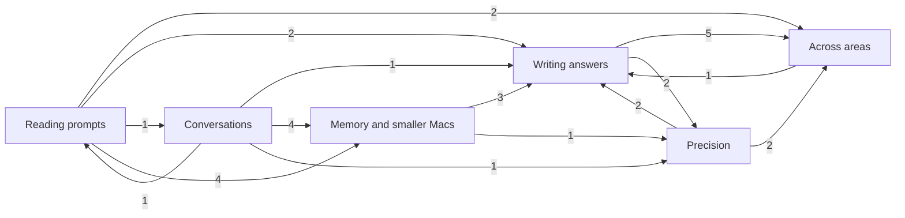
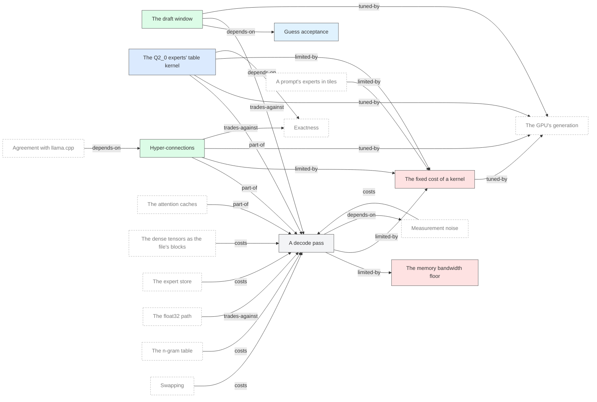
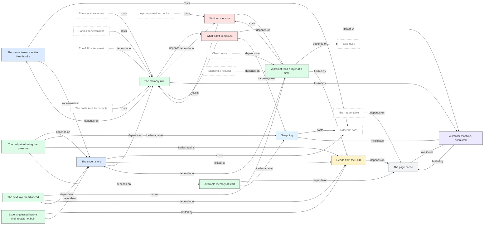
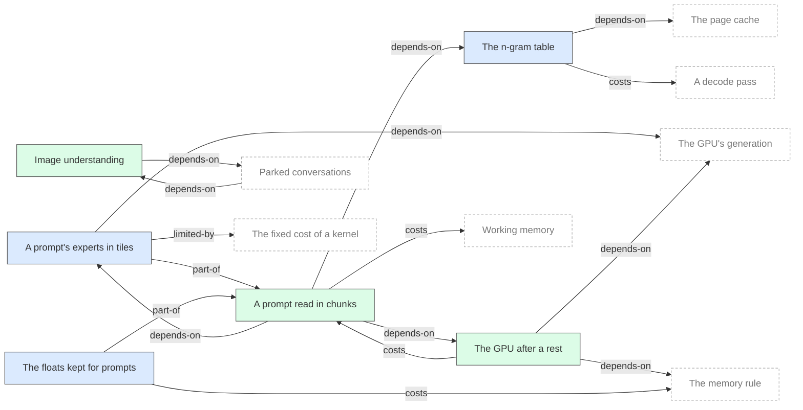
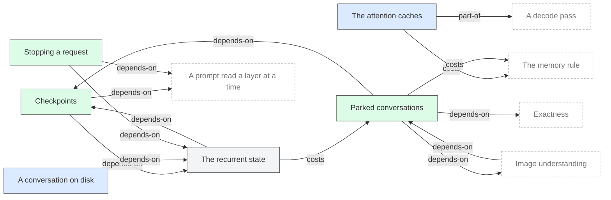
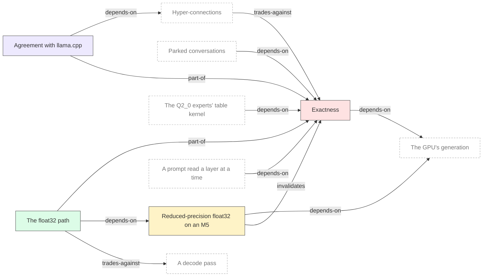
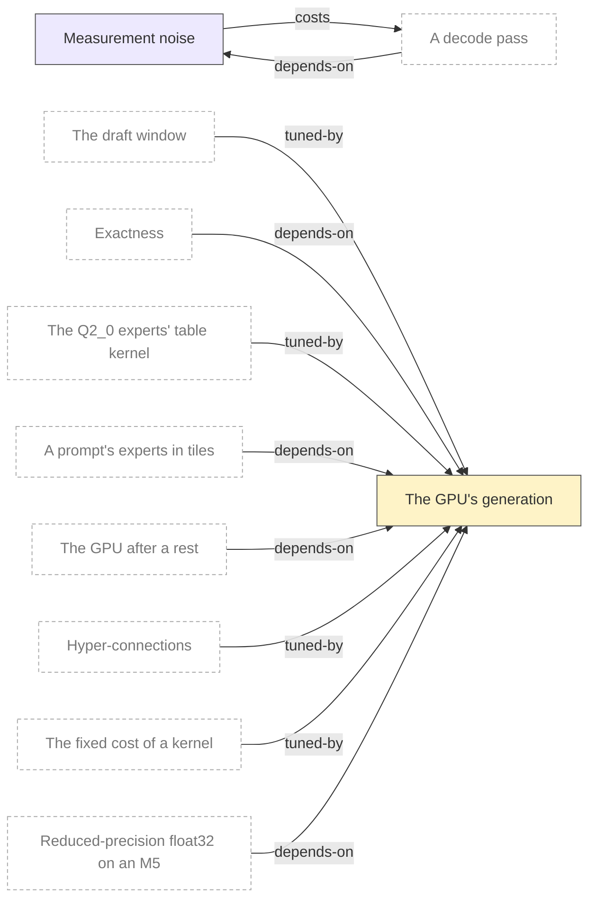

# The relations

> 中文摘要:概念之间的关系图,由 `tools/wiki_check.py --write` 生成,不要手改。先是各领域之间的总览,再是每个领域一张图:本领域的概念是实线框,其他领域的相关概念是灰色虚线框。箭头从一个概念指向它影响或依赖的概念。

Written by `tools/wiki_check.py --write` from the `## Relations` of every concept page. Do not edit.

## The areas

Relations between areas, with how many run each way.

## Writing answers

7 concepts, 24 relations touching them.

| from | relation | to | evidence |
| :--- | :--- | :--- | :--- |
| [A decode pass](concepts/decode-pass.md) | limited-by | [The memory bandwidth floor](concepts/bandwidth-floor.md) | ROADMAP: Faster answers |
| [A decode pass](concepts/decode-pass.md) | limited-by | [The fixed cost of a kernel](concepts/kernel-fixed-cost.md) | ROADMAP: Now: what is left, #9 |
| [A decode pass](concepts/decode-pass.md) | depends-on | [Measurement noise](concepts/measurement-noise.md) | e45 |
| [The draft window](concepts/draft-window.md) | depends-on | [Guess acceptance](concepts/guess-acceptance.md) | e13 |
| [The draft window](concepts/draft-window.md) | trades-against | [A decode pass](concepts/decode-pass.md) | e45 |
| [The draft window](concepts/draft-window.md) | tuned-by | [The GPU's generation](concepts/gpu-generation.md) | e45, zryukqou |
| [The Q2_0 experts' table kernel](concepts/expert-lookup-kernel.md) | part-of | [A decode pass](concepts/decode-pass.md) | e06 |
| [The Q2_0 experts' table kernel](concepts/expert-lookup-kernel.md) | tuned-by | [The GPU's generation](concepts/gpu-generation.md) | e44, e45, #9 |
| [The Q2_0 experts' table kernel](concepts/expert-lookup-kernel.md) | limited-by | [The fixed cost of a kernel](concepts/kernel-fixed-cost.md) | #9, wlqvqpzr |
| [The Q2_0 experts' table kernel](concepts/expert-lookup-kernel.md) | depends-on | [Exactness](concepts/exactness.md) | e44 |
| [Hyper-connections](concepts/hyper-connections.md) | part-of | [A decode pass](concepts/decode-pass.md) | e06 |
| [Hyper-connections](concepts/hyper-connections.md) | limited-by | [The fixed cost of a kernel](concepts/kernel-fixed-cost.md) | e07, e09, #9 |
| [Hyper-connections](concepts/hyper-connections.md) | tuned-by | [The GPU's generation](concepts/gpu-generation.md) | e45, #9, uvunqsoq, e54, #11 |
| [Hyper-connections](concepts/hyper-connections.md) | trades-against | [Exactness](concepts/exactness.md) | e18, xtxomuun |
| [The fixed cost of a kernel](concepts/kernel-fixed-cost.md) | tuned-by | [The GPU's generation](concepts/gpu-generation.md) | #9, e45 |

## Memory and smaller Macs

14 concepts, 42 relations touching them.

| from | relation | to | evidence |
| :--- | :--- | :--- | :--- |
| [Available memory at start](concepts/available-memory.md) | depends-on | [The page cache](concepts/page-cache.md) | trprrzsw, ooosmwnq |
| [Available memory at start](concepts/available-memory.md) | trades-against | [Swapping](concepts/swapping.md) | #6 |
| [The dense tensors as the file's blocks](concepts/dense-blocks.md) | costs | [A decode pass](concepts/decode-pass.md) | e36 |
| [The dense tensors as the file's blocks](concepts/dense-blocks.md) | trades-against | [The expert store](concepts/expert-store.md) | e36 |
| [The expert store](concepts/expert-store.md) | costs | [A decode pass](concepts/decode-pass.md) | ROADMAP: Macs with 16, 24 and 32 GB |
| [The expert store](concepts/expert-store.md) | limited-by | [Reads from the SSD](concepts/ssd-reads.md) | e35 |
| [The expert store](concepts/expert-store.md) | depends-on | [The memory rule](concepts/memory-rule.md) | ROADMAP: Macs with 16, 24 and 32 GB |
| [A prompt read a layer at a time](concepts/layer-major-prefill.md) | depends-on | [The expert store](concepts/expert-store.md) | utpukvqp |
| [A prompt read a layer at a time](concepts/layer-major-prefill.md) | depends-on | [Exactness](concepts/exactness.md) | e40, ROADMAP: A prompt read a layer at a time |
| [A prompt read a layer at a time](concepts/layer-major-prefill.md) | costs | [Working memory](concepts/working-memory.md) | e40 |
| [A prompt read a layer at a time](concepts/layer-major-prefill.md) | limited-by | [Reads from the SSD](concepts/ssd-reads.md) | e37, e40 |
| [The next layer read ahead](concepts/layer-read-ahead.md) | part-of | [A prompt read a layer at a time](concepts/layer-major-prefill.md) | utpukvqp |
| [The next layer read ahead](concepts/layer-read-ahead.md) | depends-on | [Reads from the SSD](concepts/ssd-reads.md) | e40 |
| [The next layer read ahead](concepts/layer-read-ahead.md) | depends-on | [The expert store](concepts/expert-store.md) | #7, volxnpkv |
| [The memory rule](concepts/memory-rule.md) | depends-on | [What is left to macOS](concepts/system-reserve.md) | zqxnwnnk, xukwosuo |
| [The memory rule](concepts/memory-rule.md) | depends-on | [Working memory](concepts/working-memory.md) | utpukvqp |
| [The memory rule](concepts/memory-rule.md) | depends-on | [The dense tensors as the file's blocks](concepts/dense-blocks.md) | e36 |
| [The memory rule](concepts/memory-rule.md) | limited-by | [A smaller machine, simulated](concepts/simulated-machine.md) | ROADMAP: Macs with 16, 24 and 32 GB, #6 |
| [The page cache](concepts/page-cache.md) | invalidates | [A smaller machine, simulated](concepts/simulated-machine.md) | ROADMAP: The dense tensors of two types |
| [The budget following the pressure](concepts/pressure-following.md) | depends-on | [The expert store](concepts/expert-store.md) | e52, yytmkrlk |
| [The budget following the pressure](concepts/pressure-following.md) | trades-against | [Swapping](concepts/swapping.md) | e52, yytmkrlk |
| [The budget following the pressure](concepts/pressure-following.md) | trades-against | [Reads from the SSD](concepts/ssd-reads.md) | e53 |
| [The budget following the pressure](concepts/pressure-following.md) | depends-on | [Available memory at start](concepts/available-memory.md) | e49, e51 |
| [Experts guessed before their router: not built](concepts/router-lookahead.md) | limited-by | [Reads from the SSD](concepts/ssd-reads.md) | e35 |
| [Experts guessed before their router: not built](concepts/router-lookahead.md) | depends-on | [The expert store](concepts/expert-store.md) | e35 |
| [A smaller machine, simulated](concepts/simulated-machine.md) | limited-by | [The page cache](concepts/page-cache.md) | e37, uoonprvo |
| [Reads from the SSD](concepts/ssd-reads.md) | depends-on | [The page cache](concepts/page-cache.md) | e38 |
| [Swapping](concepts/swapping.md) | costs | [A decode pass](concepts/decode-pass.md) | #6 |
| [Swapping](concepts/swapping.md) | invalidates | [A smaller machine, simulated](concepts/simulated-machine.md) | #6 |
| [What is left to macOS](concepts/system-reserve.md) | costs | [The memory rule](concepts/memory-rule.md) | xukwosuo |
| [What is left to macOS](concepts/system-reserve.md) | limited-by | [A smaller machine, simulated](concepts/simulated-machine.md) | #6 |
| [What is left to macOS](concepts/system-reserve.md) | trades-against | [Swapping](concepts/swapping.md) | #6, xukwosuo |
| [Working memory](concepts/working-memory.md) | costs | [The memory rule](concepts/memory-rule.md) | utpukvqp |
| [Working memory](concepts/working-memory.md) | depends-on | [A prompt read a layer at a time](concepts/layer-major-prefill.md) | e40, utpukvqp |

## Reading prompts

6 concepts, 16 relations touching them.

| from | relation | to | evidence |
| :--- | :--- | :--- | :--- |
| [A prompt's experts in tiles](concepts/expert-tiles.md) | part-of | [A prompt read in chunks](concepts/prompt-chunk.md) | e33 |
| [A prompt's experts in tiles](concepts/expert-tiles.md) | limited-by | [The fixed cost of a kernel](concepts/kernel-fixed-cost.md) | e30, e33 |
| [A prompt's experts in tiles](concepts/expert-tiles.md) | depends-on | [The GPU's generation](concepts/gpu-generation.md) | ROADMAP: What the Apple GPU can do |
| [The GPU after a rest](concepts/gpu-idle.md) | costs | [A prompt read in chunks](concepts/prompt-chunk.md) | #1, ssmutmqs |
| [The GPU after a rest](concepts/gpu-idle.md) | depends-on | [The GPU's generation](concepts/gpu-generation.md) | #7 |
| [The GPU after a rest](concepts/gpu-idle.md) | depends-on | [The memory rule](concepts/memory-rule.md) | #7, #8 |
| [Image understanding](concepts/image-understanding.md) | depends-on | [Parked conversations](concepts/conversation-parking.md) | ROADMAP: Experimental image receiver |
| [The floats kept for prompts](concepts/kept-floats.md) | costs | [The memory rule](concepts/memory-rule.md) | #3, wysxmzsy |
| [The floats kept for prompts](concepts/kept-floats.md) | part-of | [A prompt read in chunks](concepts/prompt-chunk.md) | ROADMAP: Against llama.cpp's server |
| [The n-gram table](concepts/ngram-table.md) | depends-on | [The page cache](concepts/page-cache.md) | uoonprvo, #10 |
| [The n-gram table](concepts/ngram-table.md) | costs | [A decode pass](concepts/decode-pass.md) | #10, tousqpoo |
| [A prompt read in chunks](concepts/prompt-chunk.md) | depends-on | [A prompt's experts in tiles](concepts/expert-tiles.md) | e30, e33 |
| [A prompt read in chunks](concepts/prompt-chunk.md) | depends-on | [The n-gram table](concepts/ngram-table.md) | uoonprvo |
| [A prompt read in chunks](concepts/prompt-chunk.md) | costs | [Working memory](concepts/working-memory.md) | ROADMAP: Done |
| [A prompt read in chunks](concepts/prompt-chunk.md) | depends-on | [The GPU after a rest](concepts/gpu-idle.md) | #1 |

## Conversations

6 concepts, 14 relations touching them.

| from | relation | to | evidence |
| :--- | :--- | :--- | :--- |
| [The attention caches](concepts/attention-cache.md) | costs | [The memory rule](concepts/memory-rule.md) | ROADMAP: Done |
| [The attention caches](concepts/attention-cache.md) | part-of | [A decode pass](concepts/decode-pass.md) | ROADMAP: Done |
| [Checkpoints](concepts/checkpoints.md) | depends-on | [The recurrent state](concepts/recurrent-state.md) | yumvopms |
| [Checkpoints](concepts/checkpoints.md) | depends-on | [A prompt read a layer at a time](concepts/layer-major-prefill.md) | e40 |
| [Parked conversations](concepts/conversation-parking.md) | depends-on | [Checkpoints](concepts/checkpoints.md) | yumvopms |
| [Parked conversations](concepts/conversation-parking.md) | costs | [The memory rule](concepts/memory-rule.md) | yumvopms |
| [Parked conversations](concepts/conversation-parking.md) | depends-on | [Exactness](concepts/exactness.md) | yumvopms |
| [Parked conversations](concepts/conversation-parking.md) | depends-on | [Image understanding](concepts/image-understanding.md) | ROADMAP: Experimental image receiver |
| [The recurrent state](concepts/recurrent-state.md) | costs | [Parked conversations](concepts/conversation-parking.md) | yumvopms |
| [The recurrent state](concepts/recurrent-state.md) | depends-on | [Checkpoints](concepts/checkpoints.md) | ROADMAP: Done |
| [A conversation on disk](concepts/session-files.md) | depends-on | [The recurrent state](concepts/recurrent-state.md) | ROADMAP: Done |
| [Stopping a request](concepts/stopping.md) | depends-on | [A prompt read a layer at a time](concepts/layer-major-prefill.md) | e40 |
| [Stopping a request](concepts/stopping.md) | depends-on | [The recurrent state](concepts/recurrent-state.md) | e40 |

## Precision

4 concepts, 12 relations touching them.

| from | relation | to | evidence |
| :--- | :--- | :--- | :--- |
| [Exactness](concepts/exactness.md) | depends-on | [The GPU's generation](concepts/gpu-generation.md) | #5 |
| [The float32 path](concepts/float32-path.md) | trades-against | [A decode pass](concepts/decode-pass.md) | ROADMAP: Now: what is left |
| [The float32 path](concepts/float32-path.md) | depends-on | [Reduced-precision float32 on an M5](concepts/tf32-on-m5.md) | #5, ozxszktq |
| [The float32 path](concepts/float32-path.md) | part-of | [Exactness](concepts/exactness.md) | e29 |
| [Agreement with llama.cpp](concepts/reference-agreement.md) | part-of | [Exactness](concepts/exactness.md) | ROADMAP: Done |
| [Agreement with llama.cpp](concepts/reference-agreement.md) | depends-on | [Hyper-connections](concepts/hyper-connections.md) | e18 |
| [Reduced-precision float32 on an M5](concepts/tf32-on-m5.md) | invalidates | [Exactness](concepts/exactness.md) | #5 |
| [Reduced-precision float32 on an M5](concepts/tf32-on-m5.md) | depends-on | [The GPU's generation](concepts/gpu-generation.md) | #5 |

## Across areas

2 concepts, 10 relations touching them.

| from | relation | to | evidence |
| :--- | :--- | :--- | :--- |
| [Measurement noise](concepts/measurement-noise.md) | costs | [A decode pass](concepts/decode-pass.md) | ROADMAP: Faster answers, e45 |

Colours by kind: component #dbeafe, concept #f3f4f6, constraint #fee2e2, hardware #fef3c7, mechanism #dcfce7, method #ede9fe, metric #e0f2fe; other areas dashed.

## Experiments

| experiment | concepts |
| :--- | :--- |
| [e43: the Q2_0 experts through MLX's own quantized product](experiments/e43-experts-as-qmm.md) | expert-lookup-kernel |
| [e44: threads to a row of the table kernel](experiments/e44-lookup-threads.md) | expert-lookup-kernel, gpu-generation, draft-window, guess-acceptance, measurement-noise |
| [e45: pull requests 9 and 10 checked on the M4 Max](experiments/e45-pull-request-9-check.md) | decode-pass, hyper-connections, expert-lookup-kernel, kernel-fixed-cost, gpu-generation, measurement-noise, draft-window |
| [e46: as a 48 GB machine, with the memory held](experiments/e46-held-as-48gb.md) | simulated-machine, swapping, system-reserve, measurement-noise |
| [e47: as a 32 GB machine, the memory held but not wired](experiments/e47-held-as-32gb-unwired.md) | simulated-machine, swapping, measurement-noise |
| [e48: as a 48 GB machine, the memory held and wired](experiments/e48-wired-as-48gb.md) | simulated-machine, swapping, system-reserve, expert-store, available-memory |
| [e49: as a 48 GB machine wired, the experts bounded by what was available](experiments/e49-wired-as-48gb-available.md) | available-memory, swapping, simulated-machine, system-reserve, pressure-following |
| [e50: as a quiet 32 GB machine, the memory wired](experiments/e50-quiet-as-32gb.md) | simulated-machine, swapping, system-reserve, pressure-following |
| [e51: a margin on what is available, not settled](experiments/e51-available-margin.md) | available-memory, measurement-noise, simulated-machine, pressure-following |
| [e52: letting go of arrays takes their compression off](experiments/e52-shed-compressed.md) | expert-store, swapping, available-memory, pressure-following |
| [e53: the budget following the pressure, off and on](experiments/e53-follow-pressure.md) | pressure-following |
| [e54: the fusion limit on an M5 Pro, against a control engine](experiments/e54-shared-weight-controls.md) | hyper-connections, gpu-generation, measurement-noise |
| [Official encoder and MLX image receiving](experiments/e55-vision-integration.md) | image-understanding, conversation-parking |
